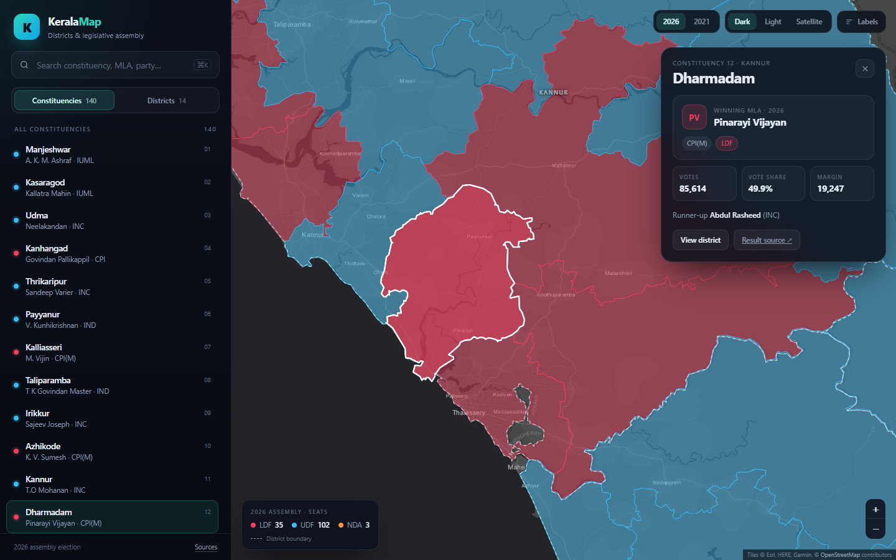
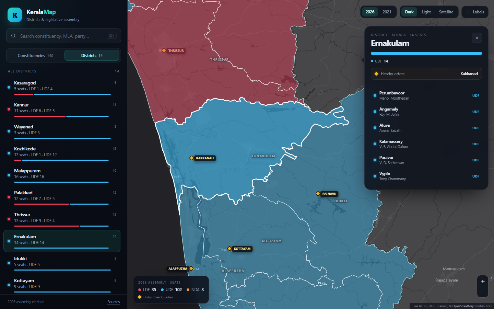

# Kerala Map

An interactive map of Kerala's **14 districts** and **140 legislative assembly
constituencies**, showing the winning MLA from the **2021 and 2026** assembly
elections. Switch the results layer from the map controls; the latest election is
shown by default.

Built as a deliberately small Python project: a FastAPI backend, SQLite for the
results, a tiny data pipeline, and a dependency-free vanilla JS + Leaflet frontend.
No Django, no frontend build step, no API keys.



District view, showing headquarters markers, seat composition and the MLA list:



## Features

- **2021 / 2026 results layers** — switch the whole map between elections.
- **Constituency choropleth** coloured by the winning alliance (LDF / UDF / NDA).
- **Hover tooltips** with the constituency, MLA name, party and alliance.
- **Click any seat** for the full result: votes, vote share, margin, runner-up,
  and a link back to the source.
- **District mode** with seat composition bars, district headquarters and a list
  of every MLA in the district.
- **Headquarters markers** with names that appear as you zoom in.
- **Search** by constituency, MLA name, party or district.
- **Shareable URLs** such as `/#ac=12`, `/#district=Ernakulam` and
  `/#year=2021&ac=12`.
- **Dark, light and satellite basemaps**, plus optional constituency labels.
- **Responsive layout** with a bottom-sheet detail panel on mobile.

## Quick start

Requires Python 3.11+ and [uv](https://docs.astral.sh/uv/).

```bash
uv sync
uv run uvicorn app.main:app --reload
```

Open <http://127.0.0.1:8000>. The app builds its SQLite cache automatically on
first start; the processed boundaries and result CSV are already committed, so
the data pipeline is **not** required to run it.

### Tests

```bash
uv run pytest
```

## API

| Endpoint | Description |
| --- | --- |
| `GET /api/meta` | Available election years, seat counts, alliances, sources |
| `GET /api/constituencies?year=2026` | All 140 results as JSON |
| `GET /api/constituencies/{ac_no}?year=2021` | One constituency result |
| `GET /api/districts?year=2026` | District summaries, seats and headquarters |
| `GET /api/district-headquarters` | The 14 headquarters with coordinates |
| `GET /api/geojson/constituencies?year=2026` | Joined constituency boundaries + results |
| `GET /api/geojson/districts?year=2026` | District boundaries + seat summaries |
| `GET /api/geojson/state` | Kerala outline |
| `GET /docs` | Interactive OpenAPI documentation |

Every election endpoint accepts `year=2021` or `year=2026` and defaults to the
latest election. GeoJSON responses are gzipped by the app and cached for five
minutes.

## Data pipeline

The raw downloads are intentionally not committed. To rebuild everything from
the pinned sources:

```bash
uv sync --extra data
uv run python -m scripts.fetch_data   # ~8 MB into data/raw/
uv run python -m scripts.build_data   # writes CSV, GeoJSON and SQLite
```

What the build does:

1. Parses the 140-row result table from a pinned revision of the Wikipedia
   article for each election (2021 and 2026).
2. Harmonises constituency names across the two tables and derives every margin
   from the winner/runner-up vote counts.
3. Dissolves the raw assembly polygons by constituency number (the source splits
   Kothamangalam across two district files) and simplifies them for the web
   (~55 m tolerance, coordinates rounded to five decimals).
4. Joins both result sets to the boundaries and writes the web payloads.
5. Validates the 14 district headquarters in `data/district_hqs.csv` against the
   result districts and rebuilds `data/kerala.db`.

Processed sizes are roughly 640 KiB for all 140 constituencies, 180 KiB for the
districts, and 55 KiB for the state outline. The GeoJSON is shared by both
elections; only the joined properties differ.

## Project layout

```text
app/
  main.py          FastAPI routes
  db.py            SQLite schema and CSV seeding
  store.py         In-memory joined dataset / GeoJSON payloads
  static/
    index.html
    css/app.css
    js/app.js      Vanilla JS + Leaflet
data/
  results.csv      Parsed 2021 + 2026 results (committed)
  district_hqs.csv District headquarters + coordinates (committed)
  processed/       Simplified GeoJSON (committed)
  raw/             Downloaded source files (gitignored)
scripts/
  fetch_data.py
  build_data.py
tests/
  test_api.py
```

## Data sources & notes

- **Boundaries:** [datta07/INDIAN-SHAPEFILES](https://github.com/datta07/INDIAN-SHAPEFILES),
  pinned to commit `7b003e3e` (2022-02-21). The files are derived from Indian
  administrative boundary datasets (DataMeet / Census of India lineage).
- **Results:** [2021](https://en.wikipedia.org/wiki/2021_Kerala_Legislative_Assembly_election)
  and [2026](https://en.wikipedia.org/wiki/2026_Kerala_Legislative_Assembly_election)
  Kerala Legislative Assembly election articles on Wikipedia, pinned to revisions
  `1378901836` and `1381519237`.
- **Headquarters:** coordinates from Wikidata, with Kakkanad cross-checked
  against OpenStreetMap.
- **Basemaps:** Esri World Dark Gray / Light Gray Canvas and World Imagery.
- **Leaflet:** loaded from unpkg; the rest of the frontend has no dependencies.

The map shows **general election winners**; by-elections held afterwards are not
reflected. Two rows in the source tables have a margin that disagrees with their
own vote totals (2021 Thiruvambady and 2026 Perumbavoor), so margins are always
derived from the vote counts. Boundaries are simplified for interactive web use
and are indicative, not survey-grade.
